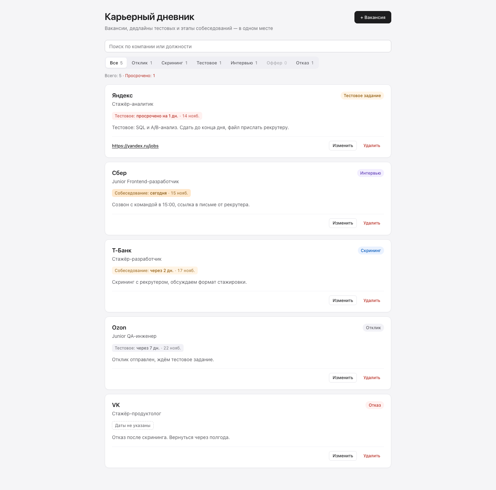
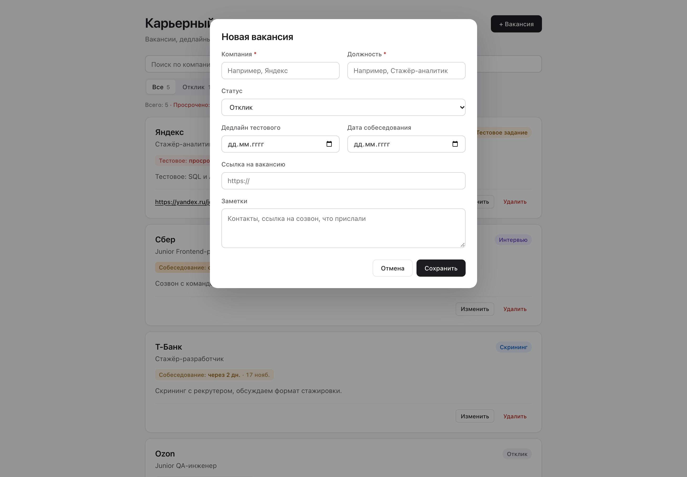
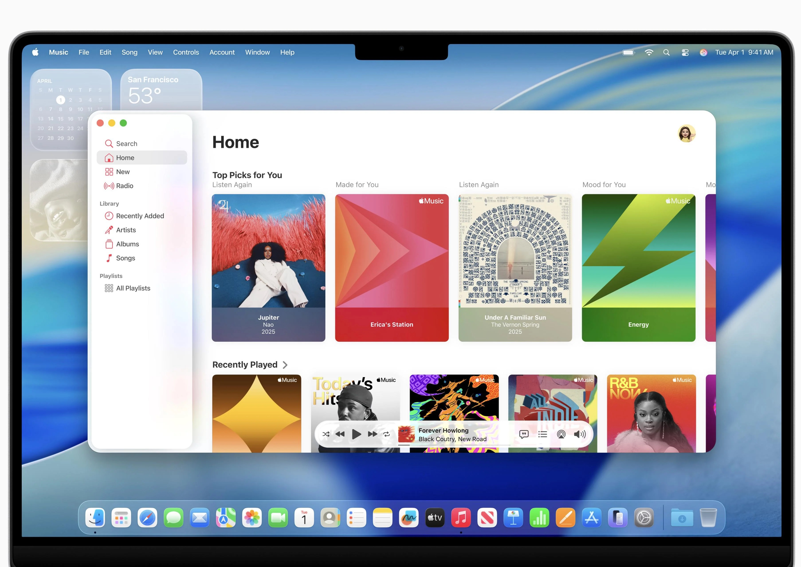

# Карьерный дневник — ПРОМЕЖУТОЧНЫЙ ЭТАП

Одностраничное локальное приложение для учёта откликов: вакансии, дедлайны тестовых заданий и этапы собеседований в одном списке. Без регистрации, сервера и сетевых запросов — данные хранятся в `localStorage` браузера.

**Промежуточный этап ИДЗ № 1.** Сделан рабочий интерфейс по референсу, продуктовая и дизайн-документация, скриншоты и первый коммит.



## Что сделано

- **Один экран + модальная форма:** шапка, поиск, Apple-style фильтр по статусам, счётчик, список карточек.
- **Создание и редактирование** вакансии в одной форме: компания, должность, статус, дедлайн тестового, дата собеседования, ссылка, заметки.
- **Валидация:** компания и должность обязательны, ссылка проверяется на `http(s)://`; ошибки показываются под полями, форма не закрывается.
- **Шесть статусов:** Отклик, Скрининг, Тестовое задание, Интервью, Оффер, Отказ — с цветными бейджами и счётчиками в фильтре.
- **Даты:** относительная подпись («сегодня», «через 2 дн.», «просрочено на 1 дн.») рядом с календарной; просроченный дедлайн тестового выделяется красным, прошедшее собеседование — нейтрально.
- **Сортировка:** просроченные тестовые → ближайшие будущие даты → остальные по времени изменения.
- **Поиск и фильтры:** поиск по компании и должности без учёта регистра и «ё»; фильтр по статусу; пустой результат со сбросом.
- **Удаление** с подтверждением, уведомления о действиях и подсветка изменённой карточки.
- **Хранение в `localStorage`** (ключ `career-diary.v1`), восстановление после перезагрузки, предупреждение при повреждённых данных.
- **Пустое состояние** с кнопкой «Загрузить примеры» (5 демо-вакансий).
- **Доступность и адаптив:** закрытие по Esc, возврат фокуса, ловушка Tab в модалках, один столбец на мобильном (проверено на 390 px).



## Референс



Референс — экран **Apple Music для macOS** (Apple Human Interface Guidelines): светлый canvas, белые поверхности, тонкие волосяные границы, системная типографика SF Pro, сдержанный графитовый акцент и Apple Segmented Control.

**Взято:** светлый фон `#F5F5F7`, белые карточки с hairline-границей, системный шрифт, сегментированный фильтр, спокойная иерархия без декора и теней.

**Не взято:** sidebar, обложки альбомов, dock, аватары, календарь и другие элементы, которых нет в PRD. Структура — своя, под задачу карьерного дневника.

Полная система токенов, компонентов и состояний — в [DESIGN.md](DESIGN.md).

## Три проверки результата

Все проверки из [PRD §9](PRD.md#9-три-конкретные-проверки-результата) пройдены:

1. **Создание и сохранение.** Вакансия добавляется, карточка появляется в списке, после перезагрузки остаётся; в `localStorage` 6 записей.
2. **Сортировка и фильтры.** Демо-набор выстраивается «просрочка → сегодня → +2 дня → +7 дней → без даты»; фильтр «Отказ» оставляет только VK; поиск «стажер» находит «Стажёр»; пустой результат предлагает сброс.
3. **Валидация, редактирование, удаление.** Пустая форма показывает 2 ошибки и не закрывается; дедлайн пересчитывается; удаление проходит через подтверждение и запись не возвращается после F5. `npm run build` проходит без ошибок.

Дополнительно прогнаны 13 сценарных проверок в headless Chrome (пустое состояние, демо-данные, сортировка, фильтр, поиск с «ё», валидация, создание, `localStorage`, перезагрузка, удаление) — 13/13.

## Стек и запуск

React 19 + Vite 7, JavaScript/JSX. Без UI-библиотек, роутера и date-библиотек.

```bash
cd site
npm install
npm run dev      # http://localhost:5173
npm run build    # production-сборка в site/dist
npm run preview  # просмотр сборки
```

## Структура репозитория

```
ИДЗ1/
├── README.md
├── PRD.md                  # продукт: сценарии, функции, данные, проверки
├── DESIGN.md               # дизайн-система: токены, компоненты, состояния
├── spec.md                 # спецификация формата DESIGN.md
├── reference.jpeg          # референс
├── docs/                   # скриншоты интерфейса
└── site/                   # само приложение
    ├── index.html
    ├── package.json
    ├── package-lock.json
    ├── vite.config.js
    └── src/
        ├── App.jsx
        ├── main.jsx
        ├── styles.css
        ├── components/     # 7 компонентов интерфейса
        ├── hooks/          # useVacancies
        └── lib/            # dates, statuses, storage, sampleData
```

`node_modules/`, `dist/` и служебные файлы macOS исключены через [.gitignore](.gitignore).

## Что сдано на промежуточном этапе

- [x] Рабочий сайт в папке `site/`, сборка `npm run build` проходит.
- [x] Референс `reference.jpeg` и разбор: что взято и что не взято.
- [x] README: что сделано, как запустить, чем подтверждено.
- [x] `PRD.md`, `DESIGN.md`, `spec.md` — продуктовая и визуальная логика.
- [x] Скриншоты списка и формы в `docs/`.
- [x] Чистая история: `.gitignore` и первый коммит без мусора.

## Ограничения первой версии

Один пользователь, только `localStorage`, без бэкенда, синхронизации, уведомлений и экспорта. Подробнее — [PRD §5](PRD.md#5-что-не-входит-в-первую-версию).
